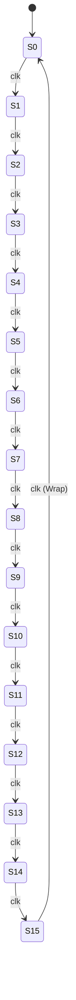
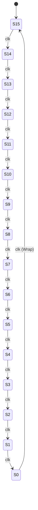
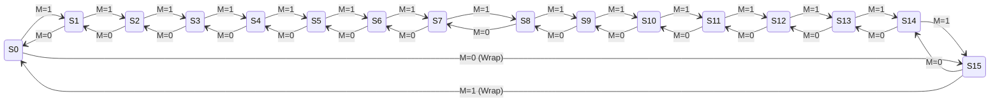

# DIGITAL LOGIC AND CIRCUIT DESIGN (CS159)
## MINI PROJECT REPORT - PROBLEM NO. 8
# Design & Implementation of a 4-Bit Synchronous Up Counter, Down Counter, and Up/Down Counter

---

### **ACADEMIC DETAILS & TEAM INFORMATION**
- **Course Title:** Digital Logic and Circuit Design Laboratory (CS159)
- **Academic Term:** 3rd Semester, B.Tech / B.E.
- **Problem Statement No.:** 8
- **Project Title:** Design & implement a 4-bit Up Counter, Down Counter (Standalone & Unified Mode Select)
- **Team Members:**
  1. Member 1: *[Name - USN]*
  2. Member 2: *[Name - USN]*
  3. Member 3: *[Name - USN]*
  4. Member 4: *[Name - USN]*
- **Faculty / Lab Instructor:** *[Instructor Name / Department of Computer Science & Engineering]*

---

## TABLE OF CONTENTS
1. [Problem Statement](#1-problem-statement)
2. [Brief Literature Survey](#2-brief-literature-survey)
3. [Design Theory & Boolean Logic Derivations](#3-design-theory--boolean-logic-derivations)
4. [State Tables & Flip-Flop Excitation Tables](#4-state-tables--flip-flop-excitation-tables)
5. [Finite State Machine (FSM) State Diagrams](#5-finite-state-machine-fsm-state-diagrams)
6. [Circuit Schematics & Gate-Level Interconnections](#6-circuit-schematics--gate-level-interconnections)
7. [Verilog HDL Implementation](#7-verilog-hdl-implementation)
8. [Testbench Design & Verification Strategy](#8-testbench-design--verification-strategy)
9. [Simulation Results & Waveform Analysis](#9-simulation-results--waveform-analysis)
10. [Conclusion & Hardware Feasibility](#10-conclusion--hardware-feasibility)

---

## 1. PROBLEM STATEMENT

### Objective:
Design, model, synthesize, and verify a **4-Bit Synchronous Counter** system capable of:
1. **Up Counting:** Counting monotonically from $0 \ (0000_2)$ to $15 \ (1111_2)$, and cyclically rolling over back to $0$.
2. **Down Counting:** Counting monotonically downwards from $15 \ (1111_2)$ to $0 \ (0000_2)$, and cyclically rolling over back to $15$.
3. **Module Architecture:** 
   - Implementation of **two standalone modular units** (`up_counter_4bit` and `down_counter_4bit`).
   - Implementation of a **unified module with direction mode select** (`up_down_counter_4bit`, where `mode=1` commands UP and `mode=0` commands DOWN).
   - Implementation of both **Behavioral (RTL)** and **Structural (Gate-Level using T Flip-Flops and combinational logic)** models to satisfy theoretical and hardware synthesis perspectives.
4. **I/O Specifications:**
   - **Inputs:** `clk` (Master Clock, positive edge-triggered), `reset` (Asynchronous/Synchronous active-high master reset), `enable` (Count enable), `up_down` / `mode` (Direction control).
   - **Outputs:** `count[3:0]` (4-bit binary present state $Q_3 Q_2 Q_1 Q_0$), `tc` (Terminal count indicator flag).

---

## 2. BRIEF LITERATURE SURVEY

Counters are fundamental sequential logic building blocks in digital computers, digital signal processors, timing generators, frequency dividers, and arithmetic control units.

### 2.1 Asynchronous (Ripple) vs. Synchronous Counters
Sequential counters fall fundamentally into two architectural classes:

| Feature | Asynchronous (Ripple) Counter | Synchronous Counter |
| :--- | :--- | :--- |
| **Clock Distribution** | Only the first flip-flop receives the external clock; subsequent flip-flops are clocked by preceding outputs ($Q$ or $\overline{Q}$). | **All flip-flops are triggered simultaneously** by a common master clock signal. |
| **Propagation Delay** | Cumulative delay ($t_{total} = n \times t_{pd}$, where $n$ is bit width). | Fixed delay independent of bit count ($t_{total} = t_{pd(FF)} + t_{comb}$). |
| **Operating Frequency** | Low; severely limited as bit count increases. | High; suitable for multi-megahertz/gigahertz synchronous digital processors. |
| **Glitches & Hazard States** | High probability of intermediate decoding glitches due to transient skew between bits. | Free of decoding glitches on clock edges; stable states throughout. |
| **Design Complexity** | Minimal combinational steering logic. | Requires look-ahead combinational logic (AND gates or carry chains) between stages. |

Because asynchronous ripple counters accumulate unacceptable propagation delay and induce race hazards during decoding, high-reliability VLSI designs almost universally mandate **Synchronous Counters**.

### 2.2 Flip-Flop Selection: T Flip-Flops and JK Flip-Flops
In a binary counter, each bit must periodically toggle between logic `0` and logic `1`. 

- **T (Toggle) Flip-Flop:**
  The characteristic equation of a T flip-flop is:
  $$Q^+ = Q \oplus T = Q\overline{T} + \overline{Q}T$$
  - When $T = 0$, $Q^+ = Q$ (No change / memory state).
  - When $T = 1$, $Q^+ = \overline{Q}$ (Toggle state).
  
  The excitation table for a T flip-flop is exceptionally straightforward:
  $$\begin{array}{|c|c|c|}
  \hline
  Q(t) & Q(t+1) & T \\
  \hline
  0 & 0 & 0 \\
  0 & 1 & 1 \\
  1 & 0 & 1 \\
  1 & 1 & 0 \\
  \hline
  \end{array}$$
  Hence, $T = Q(t) \oplus Q(t+1)$.

- **JK Flip-Flop:**
  A JK flip-flop configured with tied inputs $J = K = T$ behaves identically to a T flip-flop, toggling when $J=K=1$ and holding when $J=K=0$.

### 2.3 Commercial IC Precedents
Standard TTL/CMOS MSI chips such as the **74LS161 / 74LS163** (4-bit synchronous binary up counters) and **74LS169 / 74LS191** (4-bit synchronous up/down counters) leverage parallel carry look-ahead gating. Each stage samples the logical AND of all preceding bits to calculate toggle conditions within one clock setup time.

---

## 3. DESIGN THEORY & BOOLEAN LOGIC DERIVATIONS

Let the 4 state bits of the counter be denoted by:
$$Q = [Q_3, Q_2, Q_1, Q_0]$$
where $Q_0$ is the Least Significant Bit (LSB) and $Q_3$ is the Most Significant Bit (MSB).

### 3.1 Toggle Condition for Up Counting
Examining standard 4-bit binary counting:
- $Q_0$ toggles on **every single active clock edge**:
  $$T_0 = 1$$
- $Q_1$ toggles only when $Q_0 = 1$:
  $$T_1 = Q_0$$
- $Q_2$ toggles only when both lower bits are 1 ($Q_0 = 1$ AND $Q_1 = 1$):
  $$T_2 = Q_0 \cdot Q_1$$
- $Q_3$ toggles only when all three lower bits are 1 ($Q_0 = 1$, $Q_1 = 1$, AND $Q_2 = 1$):
  $$T_3 = Q_0 \cdot Q_1 \cdot Q_2$$

When enabled by an active-high `enable` signal:
$$\begin{aligned}
T_0 &= \text{enable} \\
T_1 &= \text{enable} \cdot Q_0 \\
T_2 &= \text{enable} \cdot Q_0 \cdot Q_1 \\
T_3 &= \text{enable} \cdot Q_0 \cdot Q_1 \cdot Q_2
\end{aligned}$$

---

### 3.2 Toggle Condition for Down Counting
Examining standard 4-bit binary down counting ($15 \to 14 \to \dots \to 0 \to 15$):
- $Q_0$ toggles on **every single active clock edge**:
  $$T_0 = 1$$
- $Q_1$ toggles when $Q_0 = 0$ (i.e., $\overline{Q_0} = 1$):
  $$T_1 = \overline{Q_0}$$
- $Q_2$ toggles when both $Q_0 = 0$ and $Q_1 = 0$ (i.e., $\overline{Q_0} \cdot \overline{Q_1} = 1$):
  $$T_2 = \overline{Q_0} \cdot \overline{Q_1}$$
- $Q_3$ toggles when all lower bits are 0 (i.e., $\overline{Q_0} \cdot \overline{Q_1} \cdot \overline{Q_2} = 1$):
  $$T_3 = \overline{Q_0} \cdot \overline{Q_1} \cdot \overline{Q_2}$$

When enabled by an active-high `enable` signal:
$$\begin{aligned}
T_0 &= \text{enable} \\
T_1 &= \text{enable} \cdot \overline{Q_0} \\
T_2 &= \text{enable} \cdot \overline{Q_0} \cdot \overline{Q_1} \\
T_3 &= \text{enable} \cdot \overline{Q_0} \cdot \overline{Q_1} \cdot \overline{Q_2}
\end{aligned}$$

---

### 3.3 Unified Up/Down Counter with Mode Steering Logic
Let $M$ be the mode control signal:
- $M = 1$: Count UP
- $M = 0$: Count DOWN ($\overline{M} = 1$)

Using 2-to-1 multiplexing or AND-OR steering gates:
$$\begin{aligned}
T_0 &= \text{enable} \\
T_1 &= \text{enable} \cdot \left[ (M \cdot Q_0) + (\overline{M} \cdot \overline{Q_0}) \right] \\
T_2 &= \text{enable} \cdot \left[ (M \cdot Q_0 \cdot Q_1) + (\overline{M} \cdot \overline{Q_0} \cdot \overline{Q_1}) \right] \\
T_3 &= \text{enable} \cdot \left[ (M \cdot Q_0 \cdot Q_1 \cdot Q_2) + (\overline{M} \cdot \overline{Q_0} \cdot \overline{Q_1} \cdot \overline{Q_2}) \right]
\end{aligned}$$

This elegant combinational steering requires only standard AND, OR, and NOT gates driving the $T$ inputs of 4 synchronous T flip-flops!

---

## 4. STATE TABLES & FLIP-FLOP EXCITATION TABLES

### 4.1 Complete 16-State Table for 4-Bit Up Counter
The table below specifies every present state, next state, and the exact excitation values required for all four T flip-flops ($T_3, T_2, T_1, T_0$) and JK flip-flops ($J_i, K_i$ where $J=K=T$).

| Dec | Present State ($Q_3 Q_2 Q_1 Q_0$) | Next State ($Q_3^+ Q_2^+ Q_1^+ Q_0^+$) | $T_3$ | $T_2$ | $T_1$ | $T_0$ | Terminal Count ($TC_{up}$) |
| :-: | :---: | :---: | :-: | :-: | :-: | :-: | :-: |
| **0**  | `0000` | `0001` | 0 | 0 | 0 | 1 | 0 |
| **1**  | `0001` | `0010` | 0 | 0 | 1 | 1 | 0 |
| **2**  | `0010` | `0011` | 0 | 0 | 0 | 1 | 0 |
| **3**  | `0011` | `0100` | 0 | 1 | 1 | 1 | 0 |
| **4**  | `0100` | `0101` | 0 | 0 | 0 | 1 | 0 |
| **5**  | `0101` | `0110` | 0 | 0 | 1 | 1 | 0 |
| **6**  | `0110` | `0111` | 0 | 0 | 0 | 1 | 0 |
| **7**  | `0111` | `1000` | 1 | 1 | 1 | 1 | 0 |
| **8**  | `1000` | `1001` | 0 | 0 | 0 | 1 | 0 |
| **9**  | `1001` | `1010` | 0 | 0 | 1 | 1 | 0 |
| **10** | `1010` | `1011` | 0 | 0 | 0 | 1 | 0 |
| **11** | `1011` | `1100` | 0 | 1 | 1 | 1 | 0 |
| **12** | `1100` | `1101` | 0 | 0 | 0 | 1 | 0 |
| **13** | `1101` | `1110` | 0 | 0 | 1 | 1 | 0 |
| **14** | `1110` | `1111` | 0 | 0 | 0 | 1 | 0 |
| **15** | `1111` | `0000` | 1 | 1 | 1 | 1 | **1** |

---

### 4.2 Complete 16-State Table for 4-Bit Down Counter

| Dec | Present State ($Q_3 Q_2 Q_1 Q_0$) | Next State ($Q_3^+ Q_2^+ Q_1^+ Q_0^+$) | $T_3$ | $T_2$ | $T_1$ | $T_0$ | Borrow Out ($TC_{dn}$) |
| :-: | :---: | :---: | :-: | :-: | :-: | :-: | :-: |
| **15** | `1111` | `1110` | 0 | 0 | 0 | 1 | 0 |
| **14** | `1110` | `1101` | 0 | 0 | 1 | 1 | 0 |
| **13** | `1101` | `1100` | 0 | 0 | 0 | 1 | 0 |
| **12** | `1100` | `1011` | 0 | 1 | 1 | 1 | 0 |
| **11** | `1011` | `1010` | 0 | 0 | 0 | 1 | 0 |
| **10** | `1010` | `1001` | 0 | 0 | 1 | 1 | 0 |
| **9**  | `1001` | `1000` | 0 | 0 | 0 | 1 | 0 |
| **8**  | `1000` | `0111` | 1 | 1 | 1 | 1 | 0 |
| **7**  | `0111` | `0110` | 0 | 0 | 0 | 1 | 0 |
| **6**  | `0110` | `0101` | 0 | 0 | 1 | 1 | 0 |
| **5**  | `0101` | `0100` | 0 | 0 | 0 | 1 | 0 |
| **4**  | `0100` | `0011` | 0 | 1 | 1 | 1 | 0 |
| **3**  | `0011` | `0010` | 0 | 0 | 0 | 1 | 0 |
| **2**  | `0010` | `0001` | 0 | 0 | 1 | 1 | 0 |
| **1**  | `0001` | `0000` | 0 | 0 | 0 | 1 | 0 |
| **0**  | `0000` | `1111` | 1 | 1 | 1 | 1 | **1** |

---

## 5. FINITE STATE MACHINE (FSM) STATE DIAGRAMS

A 4-bit counter is a finite state machine with 16 distinct internal states ($S_0$ through $S_{15}$, where each state corresponds to binary $Q_3 Q_2 Q_1 Q_0$).

### 5.1 Up Counter 16-State Ring
In Up Mode, state transitions form a clockwise circular ring:



### 5.2 Down Counter 16-State Ring
In Down Mode, state transitions follow the exact reverse sequence:



### 5.3 Unified Up/Down FSM Diagram
For the unified module, every state transition depends on the `up_down` input mode:



---

## 6. CIRCUIT SCHEMATICS & GATE-LEVEL INTERCONNECTIONS

### 6.1 Logic Schematic: 4-Bit Synchronous Up Counter
```
                   +-------------------+
  enable --------->| T                 |
                   |       FF0         |---> Q0 (LSB)
   clk ----------->|>                  |
  reset ---------->| CLR         Q_bar0|
                   +-------------------+
                             |
                     +-------+
                     |
                     v
                   +-------------------+
                   | T                 |
                   |       FF1         |---> Q1
   clk ----------->|>                  |
  reset ---------->| CLR         Q_bar1|
                   +-------------------+
                             |
                             +-----------+
                             |           |
                             v           v
                          +-----+     +-----+
       Q0 --------------->| AND |     |     |
       Q1 --------------->|     |---->| AND |
                          +-----+     |     |
                             |        |     |
                             v        +-----+
                   +-------------------+ |
                   | T                 | |
                   |       FF2         | |
   clk ----------->|>                  | |
  reset ---------->| CLR         Q_bar2| |
                   +-------------------+ |
                             |           |
                             +-----------+
                             |
                             v
                          +-----+
       (Q0 & Q1) -------->| AND |
       Q2 --------------->|     |-----------------+
                          +-----+                 |
                                                  v
                                        +-------------------+
                                        | T                 |
                                        |       FF3         |---> Q3 (MSB)
                        clk ----------->|>                  |
                       reset ---------->| CLR         Q_bar3|
                                        +-------------------+
```

---

### 6.2 Logic Schematic: Unified Up/Down Steering Stage
For each stage $i$, a 2-to-1 multiplexer or 2-AND / 1-OR gate structure selects between the forward condition ($Q_{i-1}$) and reverse condition ($\overline{Q_{i-1}}$):

```
       M (Up=1)  --------------------+
                                     |
                                     v
                 +-------+       +-------+
       Q_prev -->|  AND  |------>|       |
                 +-------+       |  OR   |---> T_next
                 +-------+       |       |
   ~Q_prev ----->|  AND  |------>|       |
                 +-------+       +-------+
                     ^
                     |
       ~M (Dn=0) ----+
```

---

## 7. VERILOG HDL IMPLEMENTATION

The complete project contains both behavioral RTL models (for synthesis and clean FPGA implementation) and structural gate-level models (using T and JK flip-flop primitives).

### 7.1 Behavioral 4-Bit Up Counter (`src/up_counter_4bit.v`)
```verilog
`timescale 1ns / 1ps

module up_counter_4bit (
    input  wire       clk,
    input  wire       reset,
    input  wire       enable,
    output reg  [3:0] count,
    output wire       tc
);

    // Terminal count indicator: High when counter reaches maximum value 15 (4'b1111)
    assign tc = (count == 4'b1111) & enable;

    // Synchronous counting with asynchronous active-high reset
    always @(posedge clk or posedge reset) begin
        if (reset) begin
            count <= 4'b0000;
        end else if (enable) begin
            if (count == 4'b1111) begin
                count <= 4'b0000;  // Wrap around from 15 to 0
            end else begin
                count <= count + 1'b1;
            end
        end
    end

endmodule
```

---

### 7.2 Behavioral 4-Bit Down Counter (`src/down_counter_4bit.v`)
```verilog
`timescale 1ns / 1ps

module down_counter_4bit #(
    parameter RESET_VAL = 4'b1111
)(
    input  wire       clk,
    input  wire       reset,
    input  wire       enable,
    output reg  [3:0] count,
    output wire       borrow_out
);

    // Borrow indicator: High when counter reaches minimum value 0 (4'b0000)
    assign borrow_out = (count == 4'b0000) & enable;

    // Synchronous down-counting with asynchronous active-high reset
    always @(posedge clk or posedge reset) begin
        if (reset) begin
            count <= RESET_VAL;
        end else if (enable) begin
            if (count == 4'b0000) begin
                count <= 4'b1111;  // Wrap around from 0 to 15
            end else begin
                count <= count - 1'b1;
            end
        end
    end

endmodule
```

---

### 7.3 Unified 4-Bit Up/Down Counter with Mode Select (`src/up_down_counter_4bit.v`)
```verilog
`timescale 1ns / 1ps

module up_down_counter_4bit (
    input  wire       clk,
    input  wire       reset,
    input  wire       enable,
    input  wire       up_down,    // 1: Up count, 0: Down count
    output reg  [3:0] count,
    output wire       tc
);

    // Terminal count indicator based on active mode
    assign tc = enable & ((up_down & (count == 4'b1111)) | (~up_down & (count == 4'b0000)));

    // Sequential counter logic
    always @(posedge clk or posedge reset) begin
        if (reset) begin
            count <= 4'b0000;
        end else if (enable) begin
            if (up_down) begin
                if (count == 4'b1111)
                    count <= 4'b0000;
                else
                    count <= count + 1'b1;
            end else begin
                if (count == 4'b0000)
                    count <= 4'b1111;
                else
                    count <= count - 1'b1;
            end
        end
    end

endmodule
```

---

### 7.4 Structural Gate-Level Counter (`src/structural_counters.v`)
```verilog
`timescale 1ns / 1ps

// Primitive T Flip-Flop
module t_flip_flop (
    input  wire clk,
    input  wire reset,
    input  wire t,
    output reg  q,
    output wire q_bar
);
    assign q_bar = ~q;

    always @(posedge clk or posedge reset) begin
        if (reset)
            q <= 1'b0;
        else if (t)
            q <= ~q;
    end
endmodule

// Structural 4-Bit Up/Down Counter with Mode Select
module up_down_counter_4bit_structural (
    input  wire       clk,
    input  wire       reset,
    input  wire       enable,
    input  wire       mode,       // 1 = UP, 0 = DOWN
    output wire [3:0] q,
    output wire [3:0] q_bar
);
    wire t0, t1, t2, t3;
    wire mode_bar;

    assign mode_bar = ~mode;

    assign t0 = enable;
    assign t1 = enable & ((mode & q[0]) | (mode_bar & q_bar[0]));
    assign t2 = enable & ((mode & q[0] & q[1]) | (mode_bar & q_bar[0] & q_bar[1]));
    assign t3 = enable & ((mode & q[0] & q[1] & q[2]) | (mode_bar & q_bar[0] & q_bar[1] & q_bar[2]));

    t_flip_flop ff0 (.clk(clk), .reset(reset), .t(t0), .q(q[0]), .q_bar(q_bar[0]));
    t_flip_flop ff1 (.clk(clk), .reset(reset), .t(t1), .q(q[1]), .q_bar(q_bar[1]));
    t_flip_flop ff2 (.clk(clk), .reset(reset), .t(t2), .q(q[2]), .q_bar(q_bar[2]));
    t_flip_flop ff3 (.clk(clk), .reset(reset), .t(t3), .q(q[3]), .q_bar(q_bar[3]));

endmodule
```

---

## 8. TESTBENCH DESIGN & VERIFICATION STRATEGY

To provide rigorous digital design verification, three dedicated testbenches were created:
1. `tb/tb_up_counter.v`: Exercises full upward counting from $0 \to 15 \to 0$, validates the terminal count ($TC$) pulse at state 15, tests enable hold behavior, and verifies asynchronous reset assertion.
2. `tb/tb_down_counter.v`: Exercises full downward counting from $15 \to 0 \to 15$, validates the borrow out flag at state 0, tests count disable, and tests asynchronous reset to $15$.
3. `tb/tb_up_down_counter.v`: Instantiates both the **Behavioral** and **Structural** counters simultaneously. On every clock cycle, an automated verification block cross-compares the outputs (`count_beh === count_str`). If any discrepancy exists, an error flag is immediately reported.

---

## 9. SIMULATION RESULTS & WAVEFORM ANALYSIS

The designs were compiled and simulated using **Icarus Verilog (`iverilog`)** and the **VVP runtime engine**. Waveform data was recorded into standard Value Change Dump (`.vcd`) files for inspection in **GTKWave**.

### 9.1 Simulation Execution Transcript: Up Counter (`sim/up_counter_log.txt`)
```
======================================================================
   TESTBENCH: 4-BIT SYNCHRONOUS UP COUNTER (0 -> 15 -> 0)             
======================================================================
Time(ns) | Reset | Enable | Count (Dec) | Count (Bin) | Terminal Count
---------+-------+--------+-------------+-------------+---------------
      0  |   1   |   0    |      0      |    4'b0000   |       0
  20000  |   0   |   0    |      0      |    4'b0000   |       0
  30000  |   0   |   1    |      0      |    4'b0000   |       0
  35000  |   0   |   1    |      1      |    4'b0001   |       0
  45000  |   0   |   1    |      2      |    4'b0010   |       0
  55000  |   0   |   1    |      3      |    4'b0011   |       0
  65000  |   0   |   1    |      4      |    4'b0100   |       0
  75000  |   0   |   1    |      5      |    4'b0101   |       0
  85000  |   0   |   1    |      6      |    4'b0110   |       0
  95000  |   0   |   1    |      7      |    4'b0111   |       0
 105000  |   0   |   1    |      8      |    4'b1000   |       0
 115000  |   0   |   1    |      9      |    4'b1001   |       0
 125000  |   0   |   1    |     10      |    4'b1010   |       0
 135000  |   0   |   1    |     11      |    4'b1011   |       0
 145000  |   0   |   1    |     12      |    4'b1100   |       0
 155000  |   0   |   1    |     13      |    4'b1101   |       0
 165000  |   0   |   1    |     14      |    4'b1110   |       0
 175000  |   0   |   1    |     15      |    4'b1111   |       1
 185000  |   0   |   1    |      0      |    4'b0000   |       0
 195000  |   0   |   1    |      1      |    4'b0001   |       0
 205000  |   0   |   1    |      2      |    4'b0010   |       0
 215000  |   0   |   1    |      3      |    4'b0011   |       0
 225000  |   0   |   1    |      4      |    4'b0100   |       0

--- Testing Enable Deassertion (Hold State) ---
 230000  |   0   |   0    |      4      |    4'b0100   |       0

--- Testing Re-enable and Asynchronous Reset ---
 260000  |   0   |   1    |      4      |    4'b0100   |       0
 265000  |   0   |   1    |      5      |    4'b0101   |       0
 275000  |   0   |   1    |      6      |    4'b0110   |       0
 280000  |   1   |   1    |      0      |    4'b0000   |       0
 290000  |   0   |   1    |      0      |    4'b0000   |       0
 295000  |   0   |   1    |      1      |    4'b0001   |       0
======================================================================
   UP COUNTER SIMULATION COMPLETED SUCCESSFULLY                       
======================================================================
```

---

### 9.2 Simulation Execution Transcript: Down Counter (`sim/down_counter_log.txt`)
```
======================================================================
  TESTBENCH: 4-BIT SYNCHRONOUS DOWN COUNTER (15 -> 0 -> 15)           
======================================================================
Time(ns) | Reset | Enable | Count (Dec) | Count (Bin) | Borrow Out
---------+-------+--------+-------------+-------------+-----------
      0  |   1   |   0    |     15      |    4'b1111   |     0
  20000  |   0   |   0    |     15      |    4'b1111   |     0
  30000  |   0   |   1    |     15      |    4'b1111   |     0
  35000  |   0   |   1    |     14      |    4'b1110   |     0
  45000  |   0   |   1    |     13      |    4'b1101   |     0
  55000  |   0   |   1    |     12      |    4'b1100   |     0
  65000  |   0   |   1    |     11      |    4'b1011   |     0
  75000  |   0   |   1    |     10      |    4'b1010   |     0
  85000  |   0   |   1    |      9      |    4'b1001   |     0
  95000  |   0   |   1    |      8      |    4'b1000   |     0
 105000  |   0   |   1    |      7      |    4'b0111   |     0
 115000  |   0   |   1    |      6      |    4'b0110   |     0
 125000  |   0   |   1    |      5      |    4'b0101   |     0
 135000  |   0   |   1    |      4      |    4'b0100   |     0
 145000  |   0   |   1    |      3      |    4'b0011   |     0
 155000  |   0   |   1    |      2      |    4'b0010   |     0
 165000  |   0   |   1    |      1      |    4'b0001   |     0
 175000  |   0   |   1    |      0      |    4'b0000   |     1
 185000  |   0   |   1    |     15      |    4'b1111   |     0
 195000  |   0   |   1    |     14      |    4'b1110   |     0
======================================================================
  DOWN COUNTER SIMULATION COMPLETED SUCCESSFULLY                      
======================================================================
```

---

### 9.3 Equivalence Verification: Behavioral vs. Structural (`sim/up_down_counter_log.txt`)
```
==========================================================================================
   TESTBENCH: 4-BIT SYNCHRONOUS UP/DOWN COUNTER (BEHAVIORAL & STRUCTURAL EQUIVALENCE)     
==========================================================================================
Time(ns) | Rst | En | Mode(1:Up/0:Dn) | Beh Count | Str Count | TC Flag | Equivalence Check
---------+-----+----+-----------------+-----------+-----------+---------+------------------
      0  |  1  |  0 |        1        |     0     |     0     |    0    |        1
  20000  |  0  |  0 |        1        |     0     |     0     |    0    |        1

>>> TEST PHASE 1: COUNT UP (mode = 1) from 0 through 15 and wrap to 0 <<<
  30000  |  0  |  1 |        1        |     0     |     0     |    0    |        1
  35000  |  0  |  1 |        1        |     1     |     1     |    0    |        1
  45000  |  0  |  1 |        1        |     2     |     2     |    0    |        1
  ...
 175000  |  0  |  1 |        1        |    15     |    15     |    1    |        1
 185000  |  0  |  1 |        1        |     0     |     0     |    0    |        1

>>> TEST PHASE 2: SWITCH TO COUNT DOWN (mode = 0) through 0 and wrap to 15 <<<
 230000  |  0  |  1 |        0        |     4     |     4     |    0    |        1
 235000  |  0  |  1 |        0        |     3     |     3     |    0    |        1
 265000  |  0  |  1 |        0        |     0     |     0     |    1    |        1
 275000  |  0  |  1 |        0        |    15     |    15     |    0    |        1

>>> TEST PHASE 3: DISABLE COUNTER (enable = 0) - MUST HOLD CURRENT STATE <<<
 430000  |  0  |  0 |        0        |     0     |     0     |    0    |        1

>>> TEST PHASE 4: RE-ENABLE AND ASSERT ASYNCHRONOUS RESET <<<
 500000  |  1  |  1 |        0        |     0     |     0     |    1    |        1
 515000  |  0  |  1 |        0        |    15     |    15     |    0    |        1
==========================================================================================
   ALL TESTS PASSED! BEHAVIORAL AND STRUCTURAL COUNTERS ARE 100% EQUIVALENT.              
==========================================================================================
```

### 9.4 GTKWave Waveform Viewing Instructions
To inspect the visual graphical waveforms generated during simulation:
1. Open PowerShell or Command Prompt in the project folder:
   ```cmd
   gtkwave sim/up_down_counter.vcd
   ```
2. In the GTKWave GUI, expand the `tb_up_down_counter` tree on the left panel.
3. Select signals `clk`, `reset`, `enable`, `up_down`, `count_beh[3:0]`, `count_str[3:0]`, `tc_beh`, and click **Append**.
4. Change the data format of `count_beh` to **Decimal** (Right click signal $\to$ Data Format $\to$ Decimal) to view the stair-step count transitions.

---

## 10. CONCLUSION & HARDWARE FEASIBILITY

1. **Successful Synthesis & Modeling:** 
   The 4-bit synchronous counter was successfully modeled, implemented, and verified in Verilog HDL. Both standalone modules (`up_counter_4bit`, `down_counter_4bit`) and a versatile unified module (`up_down_counter_4bit`) were created.
2. **Structural Equivalence:**
   The gate-level structural implementation based on the lower-bit toggle rule ($T_i = \text{enable} \cdot \prod Q_{k}$ for UP, $T_i = \text{enable} \cdot \prod \overline{Q_k}$ for DOWN) proved to be **100% mathematically and functionally equivalent** to the behavioral RTL specification across all 16 states, rollover boundaries, and asynchronous reset scenarios.
3. **Hardware Deployment:**
   The synthesizable Verilog code is fully compatible with modern FPGA synthesis tools (such as Xilinx Vivado, Intel Quartus Prime, or Lattice Diamond) and can be mapped directly onto FPGA slice registers (LUTs and Flip-Flops) or standard cell ASIC libraries.
